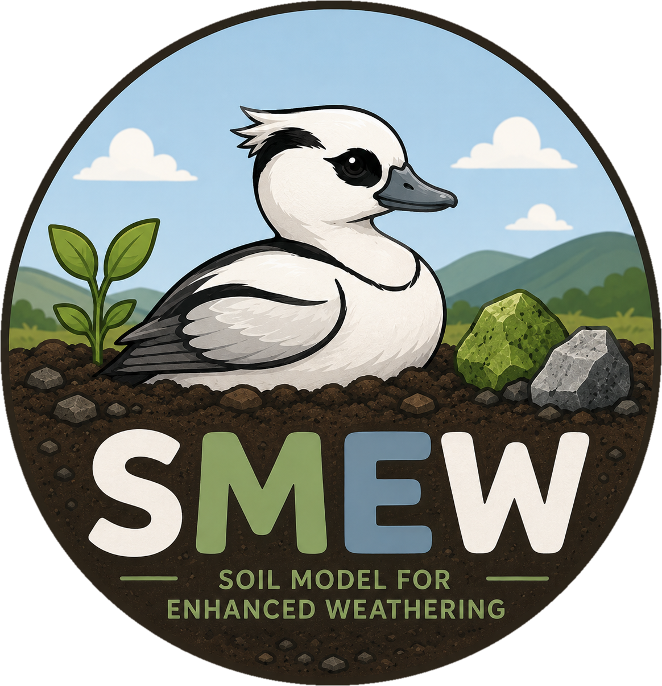

<p align="center">
  
</p>

# Soil Model for Enhanced Weathering (SMEW)

[](https://pypi.org/project/smew/)
[](https://pypi.org/project/smew/)
[](https://pypistats.org/packages/smew)
[](https://doi.org/10.5281/zenodo.14356660)
[](https://doi.org/10.1029/2024MS004224)
[](https://github.com/MatteoBertagni/SMEW/actions/workflows/tests.yml)
[](https://github.com/MatteoBertagni/SMEW/actions/workflows/python-publish.yml)
[](https://matteobertagni.github.io/SMEW/)
[](https://github.com/MatteoBertagni/SMEW/blob/main/LICENSE.txt)

This repository contains the Soil Model for Enhanced Weathering (SMEW), with associated examples notebooks and experimental data, initially released with [Bertagni et al., 2025, JAMES](https://doi.org/10.1029/2024MS004224).
SMEW is a dynamic, depth-averaged ecohydrological and biogeochemical model for enhanced weathering dynamics in the upper soil layers.

Article: [https://doi.org/10.1029/2024MS004224](https://doi.org/10.1029/2024MS004224)\
Documentation: [https://matteobertagni.github.io/SMEW/](https://matteobertagni.github.io/SMEW/)\
Zenodo repository: [https://doi.org/10.5281/zenodo.14356660](https://doi.org/10.5281/zenodo.14356660)\
GitHub repository: [https://github.com/MatteoBertagni/SMEW](https://github.com/MatteoBertagni/SMEW)\
PyPi package: [https://pypi.org/project/smew](https://pypi.org/project/smew)


## Quick start

With Python 3.11 or newer, install with:

```bash
pip install smew
```

This installs SMEW from PyPI, including precompiled code when a compatible package is available for your platform.

If installation asks for a C compiler, see the 
[installation guide](https://matteobertagni.github.io/SMEW/installation.html) for setup instructions and 
compiler-free alternatives.

Once installed, download the example notebook located in [notebooks/Example.ipynb](notebooks/Example.ipynb).
Open it with Jupyter and run all cells!

To run the model–experiment comparisons, download or clone the full repository so the notebooks and experimental data 
stay together.
If you move the files, update the data path near the top of each notebook.


## Choose how the model runs

SMEW provides two modes using the same chemical equations:

- **Compiled mode (default):** uses Numba, Cython equations and cminpack for
  faster simulations. The first calculation in each Python session includes
  compilation time for Numba.
- **Python mode:** uses Python equations and SciPy’s `fsolve`, making it easier
  to inspect calculations and test equation changes.

To select a mode, put this in the **first notebook cell** or at the top of
your script (like in the example notebook), before importing SMEW or Numba:

```python
import os

os.environ["NUMBA_DISABLE_JIT"] = "1"  # "1": Python; "0": compiled
import smew
```

After changing modes, **restart the kernel and run all cells**.
Compiled chemistry calculations require the native extensions included in
release wheels.

When comparing Python and compiled modes, use the same rainfall input array.
Setting the same random seed in both modes does not guarantee identical rainfall.

See the [example notebook](https://matteobertagni.github.io/SMEW/_generated/Example.html) to get started,
[solver guide](https://matteobertagni.github.io/SMEW/solver.html) for numerical details, and
[troubleshooting](https://matteobertagni.github.io/SMEW/errors.html) for warnings and failed simulations.


## Folders

- `src/smew`: contains the Python code for the SMEW numerical model
- `docs`: contains the Sphinx documentation of SMEW
- `tests`: contains the test suite of SMEW
- `notebooks`: contains the example and model-experiment comparison Jupyter notebooks
- `notebooks/Exp_data`: contains the experimental data obtained from the various publications through a web plot digitizer (https://apps.automeris.io/wpd/)
- `third_party`: contains bundled dependencies: pyeto for potential evapotranspiration (Mark Richards, https://pyeto.readthedocs.io/en/latest/index.html) and the cminpack solver


## Jupyter notebooks

- `Example`: provides an example of simulation for an EW application 
- `Vials_Dietzen`: model-experiment comparisons with the experiments by Dietzen et al. (2018)
- `Bottles_tePas`: model-experiment comparisons with the experiments by tePas et al. (2023)
- `Mesocosm_Amann`: model-experiment comparisons with the experiments by Amann et al. (2020)
- `Mesocosm_Kelland`: model-experiment comparisons with the experiments by Kelland et al. (2020)


## Documentation

Read the [online documentation](https://matteobertagni.github.io/SMEW/).

The Sphinx documentation uses this README as its landing page and has four main
sections:

- [Getting started](https://matteobertagni.github.io/SMEW/getting-started.html): installation and running the
  [Example notebook](https://matteobertagni.github.io/SMEW/_generated/Example.html).
- [User guide](https://matteobertagni.github.io/SMEW/user-guide.html): preparing simulations, choosing Python or
  compiled mode, and understanding warnings and failed calculations.
- [Model development](https://matteobertagni.github.io/SMEW/model-development.html): how the chemical equations
  are solved, how to change and test them, how to update the documentation, and
  how to publish releases.
- [API reference](https://matteobertagni.github.io/SMEW/reference/index.html): function signatures and descriptions
  drawn from the source code's docstrings.

From the repository, build it with:

```bash
python -m pip install -e '.[docs]'  # install the libraries to build the docs
make docs  # make the documentation using make (see the documentation for windows commands)
```

Open `docs/_build/html/index.html`.

See [documentation maintenance](https://matteobertagni.github.io/SMEW/contributing.html) for more details.

## Development and model testing

With Python 3.11+ and a C compiler, run these commands from the cloned repository root:

```bash
pip install -e '.[dev]'
make test     # full-year comparisons and physical-range checks in both modes
make example  # open the interactive marimo example
```

After changing compiled equations, run `make install-native` and restart Python.

See the [test guide](tests/README.md) for test setup and reference updates,
and [installation and builds](https://matteobertagni.github.io/SMEW/installation.html)
for compiler-free setup, packaging and other build commands.


## License

This project is licensed under the GNU Affero General Public License v3.0 (AGPL-3.0).

See the `LICENSE.txt` file for details.

SMEW bundles pyeto under the BSD license in
[third_party/pyeto/LICENSE.txt](third_party/pyeto/LICENSE.txt).

SMEW includes cminpack's hybrid solver source under the terms in
[third_party/cminpack/CopyrightMINPACK.txt](third_party/cminpack/CopyrightMINPACK.txt).
This product includes software developed by the University of Chicago, as
Operator of Argonne National Laboratory.

## Contact

You can contact me at @MatteoBertagni ([matteo.bertagni@polito.it](mailto:matteo.bertagni@polito.it)) for more information about the research.
