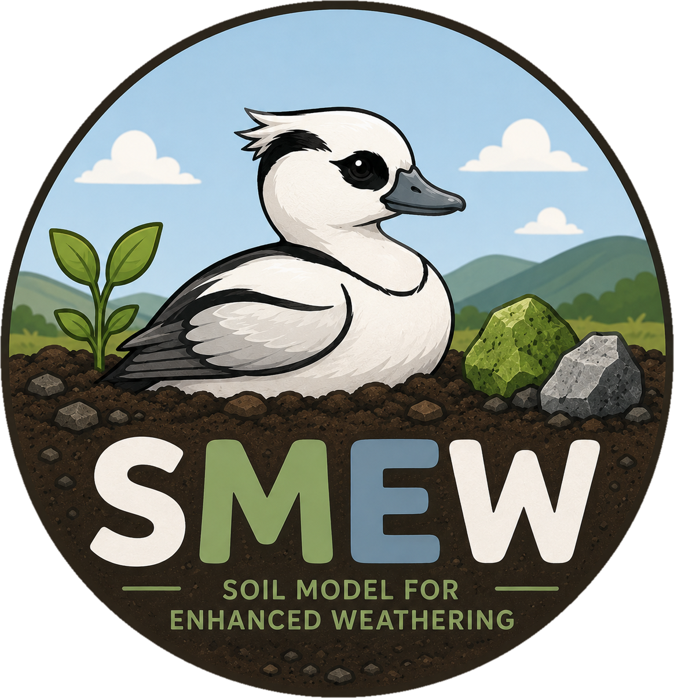

<p align="center">
  
</p>

# Soil Model for Enhanced Weathering (SMEW)

This folder contains all material related to the Soil Model for Enhanced Weathering (SMEW) published in Bertagni et al., 2025, JAMES
The material includes the numerical codes for the model, the experimental data used for the analyses, and the Jupyter notebooks for the model-experiment comparison.

Article: [https://doi.org/10.1029/2024MS004224](https://doi.org/10.1029/2024MS004224)\
Zenodo repository: [https://doi.org/10.5281/zenodo.14356660](https://doi.org/10.5281/zenodo.14356660)\
GitHub repository: [https://github.com/MatteoBertagni/SMEW](https://github.com/MatteoBertagni/SMEW)\
PyPi package: [https://pypi.org/project/smew](https://pypi.org/project/smew)

Install with:

```bash
pip install smew
```

Release wheels contain the compiled Cython equations and bundled cminpack solver;
installing a matching wheel requires no C compiler. Wheels are built for CPython
3.11–3.14 on Linux x86-64 and ARM64 (glibc 2.28+), macOS Apple Silicon
(macOS 11+), and Windows x86-64. Intel macOS wheels support CPython 3.11–3.13
and use Numba 0.62, the last series with upstream Intel macOS binaries
([Numba release notes](https://numba.readthedocs.io/en/stable/release/0.62.0-notes.html)).
Dependencies may impose newer OS requirements.
Alpine/musl, Windows ARM64, and free-threaded Python are not currently wheel targets.
If no matching wheel exists, pip attempts to build the source distribution and
requires a C compiler. To require a SMEW wheel instead, use
`python -m pip install --only-binary=smew smew`.

Numerical calculations use ordinary Numba `@njit` decorators, including
vegetation, temperature, rainfall, moisture, organic carbon, soil pores,
weathering, initialization, and the main biogeochemistry model. Compilation happens
on the first call. `ET0` and plotting functions remain Python.

Choose the solver mode in the **first cell of a notebook** or at the top of a
script, before importing Numba or SMEW:

```python
import os

os.environ["NUMBA_DISABLE_JIT"] = "1"  # "1": Python/SciPy; "0": Numba/Cython/cminpack
import smew
```

Use `"1"` to disable Numba and `"0"` to enable it. After changing this value
in a notebook, restart the kernel and run all cells from the top. The
[Example notebook](Example.ipynb) shows how to use this option. SMEW's
default when this variable is unset is Numba enabled.

SMEW solves coupled nonlinear equations to find quantities such as soil pH and
dissolved ion concentrations that satisfy the model's chemical balances and
equilibrium relations. With Numba enabled, it uses **cminpack**, a numerical
solver written in C, together with compiled versions of SMEW's equations. This
is called the **native solver** because it runs as compiled machine code.
With Numba disabled, SMEW solves these equations using SciPy's `fsolve` and
the Python versions of the equations.

The native solver is loaded only when these nonlinear equations need to be
solved in Numba mode. Other calculations, such as temperature, rainfall and
vegetation growth, can use Numba without the native solver installed.

Small Python entry-point wrappers handle array conversion, solver
warnings, numerical failures, and result dictionaries. In particular, failed
compiled simulations return before Python raises the exception, so Numba can
release their arrays. This matters when a worker runs many simulations in the
same process to avoid memory leaks.
Errors expose a globally unique `ErrorCode` and a debug message containing the
failing component, timestep, and relevant numerical values. Python callers can
catch `smew.SMEWError`; compiled callers use the public `*_numba` entry points,
which return `(result, error_code, error_message)` without raising. See
[model failures](docs/errors.rst) for examples and supported interfaces.
The deprecated two-application model returns named numerical results, but its
outer loop and nonlinear solves still use Python/SciPy.

Stochastic rainfall uses NumPy's exponential sampler. Numba maintains its own
random state, so Python and compiled rainfall runs need not produce identical
samples. Numba's disk cache is disabled because the solver uses process-local
function pointers.

## Folders

- `smew`: contains the python codes for the SMEW numerical model
- `Exp_data`: contains the experimental data obtained from the various publications through a web plot digitizer (https://apps.automeris.io/wpd/)
- `pyeto`: contains the Python codes to estimate the potential evapotranspiration (Mark Richards, https://pyeto.readthedocs.io/en/latest/index.html)


## Jupyter notebooks

- `Example`: provides an example of simulation for an EW application 
- `Vials_Dietzen`: model-experiment comparisons with the experiments by Dietzen et al. (2018)
- `Bottles_tePas`: model-experiment comparisons with the experiments by tePas et al. (2023)
- `Mesocosm_Amann`: model-experiment comparisons with the experiments by Amann et al. (2020)
- `Mesocosm_Kelland`: model-experiment comparisons with the experiments by Kelland et al. (2020)


## Instructions

1. Download or pull the whole repository into a selected working directory.
2. Run the Jupyter notebook 'Example' to verify that the model components (smew) are correctly used within the notebooks.
3. Change the parameters in the file 'Example' to run specific simulations for different scenarios.
4. For the Jupyter notebooks of the model-experiment comparison, define the selected base directory in the first cell of each notebook.

## Documentation

Read the [online documentation](https://matteobertagni.github.io/SMEW/).

The Sphinx documentation uses this README as its landing page and has four main
sections:

- [Getting started](docs/getting-started.rst): installation and running the
  [Example notebook](Example.ipynb).
- [User guide](docs/user-guide.rst): preparing simulations, choosing Python or
  compiled mode, and understanding warnings and failed calculations.
- [Model development](docs/model-development.rst): how the chemical equations
  are solved, how to change and test them, how to update the documentation, and
  how to publish releases.
- [API reference](docs/reference/index.rst): function signatures and descriptions
  drawn from the source code's docstrings.

From the repository, build it with:

```bash
python -m pip install -e '.[docs]'  # install the libraries to build the docs
make docs  # make the documentation using make (see the documentation for windows commands)
```

Open `docs/_build/html/index.html`.

See [documentation maintenance](docs/contributing.rst) for more details.

## Development and model testing

Requires Python 3.11+. Once the repository cloned, install with `pip install -e '.[dev]'`,
then run `make test` for full-year time-series comparisons and physical-range checks.
Use `make example` to open the marimo example with plots generated on demand.
See [tests/README.md](tests/README.md) for setup and reference updates.

`make build` (or `make build-native`) creates a source archive and wheel with
the private Cython equations and cminpack solver extensions.
`make install-native` rebuilds them in the active editable installation after
equation changes. Use
`make install-python` for a source installation without a C compiler, or
`make build-python` to package that variant. `make clean-build` removes generated
package build files, native extensions and distributions. `make clean-docs`
removes generated documentation, and `make clean` runs both. The Python source remains
available as `smew.equations`; restart the Python process after a native
rebuild.

`SMEW_BUILD_NATIVE=0` disables the C extensions. Build dependencies, including
Cython, are installed by pip in an isolated build environment.

### Release packaging

Releases are built and tested automatically through GitHub Actions before
publication to PyPI. See the [release guide](docs/releasing.rst) for packaging
checks and release instructions.

## License

This project is licensed under the GNU Affero General Public License v3.0 (AGPL-3.0).

See the `LICENSE.txt` file for details.

SMEW includes cminpack's hybrid solver source under the terms in
[third_party/cminpack/CopyrightMINPACK.txt](third_party/cminpack/CopyrightMINPACK.txt).
This product includes software developed by the University of Chicago, as
Operator of Argonne National Laboratory.

## Contact

You can contact me at @MatteoBertagni ([matteo.bertagni@polito.it](mailto:matteo.bertagni@polito.it)) for more information about the research.
